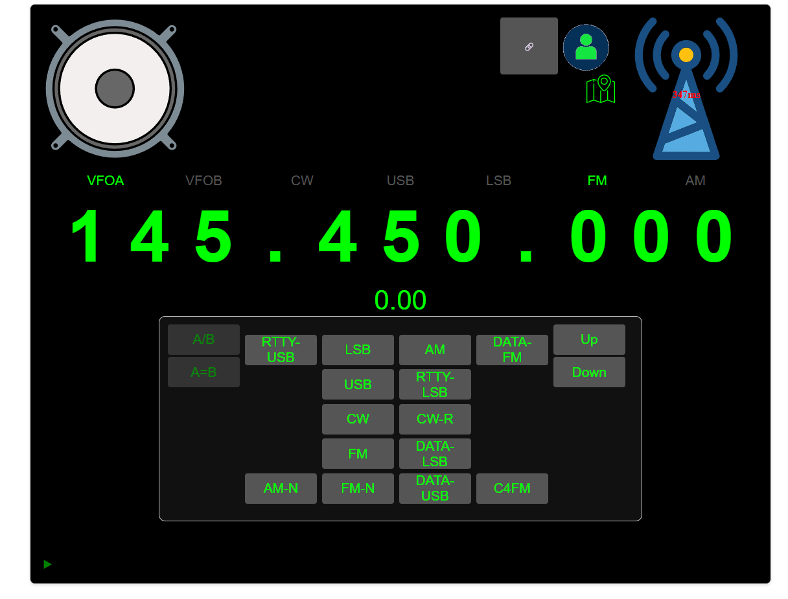
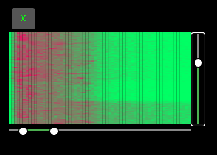
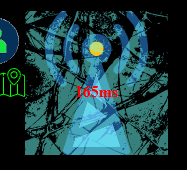

\# Setup del progetto



Questo progetto utilizza un ambiente virtuale Python (`venv`) che \*\*non è incluso nel repository\*\*.  

Per iniziare, esegui lo script di setup che crea automaticamente il venv e installa le dipendenze.


Setup (Windows)


Apri PowerShell nella cartella del progetto ed esegui:


```powershell
powershell -ExecutionPolicy Bypass -File setup.ps1
```

Avvio del progetto

Ogni volta che vuoi avviare il progetto:

```powershell
.\\venv\\Scripts\\Activate.ps1
python .\\server.py
```

Nuove funzionalità
Condivisione collegamento radio

È stato aggiunto il pulsante Condividi, che permette di condividere rapidamente il collegamento della radio attualmente in ascolto.

Lista utenti lato host

È stata aggiunta una schermata dedicata all'host che mostra l'elenco degli utenti collegati.

Posizione

È stato aggiunto il pulsante Posizione.

Attualmente questa funzione consente solamente di visualizzare e memorizzare la posizione locale del dispositivo. L'invio della posizione ad altri utenti non è ancora implementato.

Filtri audio

Cliccando col destro da pc o tenendo premuto sull'icona dell'altoparlante sono ora disponibili diversi filtri audio per personalizzare l'ascolto della radio.



Indicatore risparmio energetico

Quando il client visualizza l'antenna congelata o non aggiornata, significa generalmente che il dispositivo host è entrato in modalità di risparmio energetico e ha sospeso parte delle attività dell'applicazione.




Problemi noti
Alcuni pulsanti potrebbero non rispondere correttamente in determinate situazioni.
Alcune funzionalità sono ancora in fase di sviluppo e potrebbero essere soggette a modifiche nelle prossime versioni.


> Nota importante  

> Il progetto potrebbe avere problemi nell’accesso all’audio se eseguito senza HTTPS.  

> Si consiglia di utilizzare un dispositivo o un ambiente dotato di certificati SSL validi.


versione 2.6.0

aggiunta della confugurazzione custom (per ora solo per visualizzare le configurazzioni) l'utilizzo potrebbe comportare problemi 

problemi molti pulsanti hanno smesso di funzionare